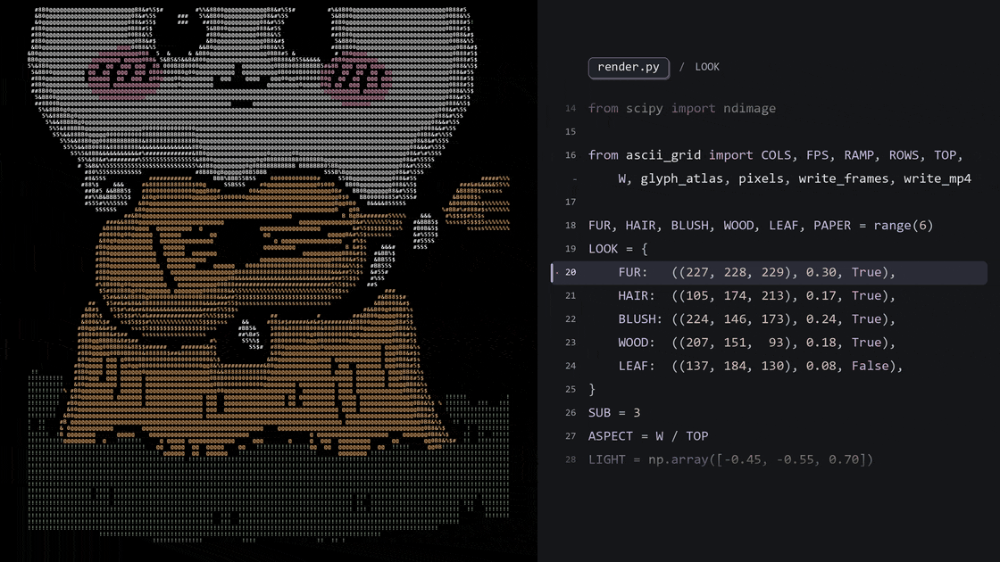
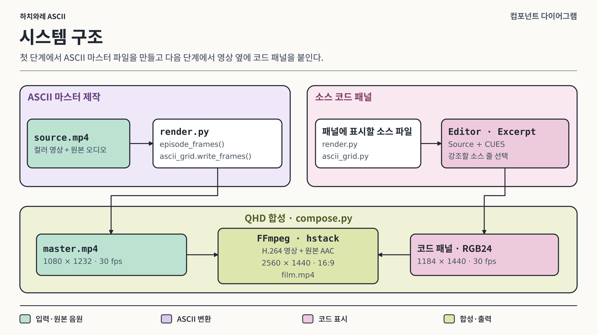

# 하치와레의 혼잣말 · ASCII로 그린 영상

[English](README.md) · [완성 영상 보기 · YouTube](https://youtu.be/brybTT7F2sg?si=imUgZBDhkl2_aS32) · [설계 다이어그램 8종](docs/design.ko.md)

하치와레가 기타를 치는 모습을 왼쪽 화면에 색색의 ASCII 문자로 그렸습니다. 오른쪽에서는 장면에 맞춰 파이썬 코드가 한 줄씩 내려갑니다. 28.3초에 박수 장면이 나오면 스크롤이 잠시 멈춥니다. 이 장면의 구도는 `render.py` 248번째 줄에서 정합니다. 노래와 대사는 한국어판 원본 그대로 들을 수 있습니다. [박수 장면의 코드](render.py#L248)

## 영상 만들기

파이썬과 `ffmpeg`, `ffprobe`가 필요합니다. FFmpeg는 `libx264`를 지원하는 빌드를 사용하세요. 코드 패널의 영문에는 DejaVu Sans Mono 또는 Consolas를, 한글에는 Noto Sans KR, Noto Sans CJK KR 또는 맑은 고딕을 씁니다. 아래 명령은 저장소 폴더에서 실행합니다.

~~~bash
python -m venv .venv
source .venv/bin/activate
python -m pip install -r requirements.txt
~~~

Windows PowerShell에서는 `.\.venv\Scripts\Activate.ps1`로 가상 환경을 켭니다.

한국어판 11화 「혼잣말」 원본을 `source.mp4`라는 이름으로 준비하세요. 이 편집본을 30 fps로 읽으면 총 2,701프레임입니다. 첫 번째 명령은 원본 소리가 담긴 1080 × 1232 ASCII 영상을 만듭니다. 두 번째 명령은 그 옆에 코드를 붙여 2560 × 1440(16:9) MP4로 저장합니다.

~~~bash
python render.py --episode-11 source.mp4 master.mp4
python compose.py master.mp4 film.mp4
~~~

이미 `master.mp4`가 있으면 두 번째 명령부터 실행하세요. 같은 영상을 다시 만들 때는 새 출력 파일명을 지정하세요. 완성본은 30 fps로 약 90초 동안 재생됩니다. 두 단계 모두 원본 AAC를 재인코딩하지 않고 복사합니다.

다른 영상으로 문자 표현을 시험해 볼 수도 있습니다. 다음 명령은 입력 영상에 맞춰 구도를 잡고 1080 × 1232 무음 ASCII 영상을 만듭니다.

~~~bash
python render.py input.mp4 ascii.mp4
~~~

## 영상과 코드는 어떻게 맞출까?

`CUES`에는 20개 구간의 시작 프레임과 그때 보여 줄 소스 줄 번호가 들어 있습니다. 처음 3초는 타이틀을 그리는 코드를 보여 줍니다. 기타 연주가 시작되는 90번 프레임부터는 털과 기타에 쓰는 색상표로 넘어갑니다. [장면별 코드 목록](compose.py#L59)

| 파일 | 하는 일 |
| --- | --- |
| [render.py](render.py) | 털, 머리, 기타의 색을 구분하고 장면마다 구도와 글자 밀도를 정합니다. |
| [ascii_grid.py](ascii_grid.py) | 글자마다 밝기 마스크를 만들고 격자에 색을 입혀 영상으로 저장합니다. |
| [compose.py](compose.py) | 실제 소스 줄을 읽어 오른쪽 패널에 표시하고 원본 오디오와 함께 QHD로 합성합니다. |

장면이 바뀔 때 어떤 함수를 호출하는지, 같은 줄에서 스크롤이 왜 멈추는지는 설계 문서에서 그림과 코드로 확인할 수 있습니다. [한국어 설계 문서](docs/design.ko.md)

## 라이선스

김경보(Kyung-Bo Kim)가 공개한 코드와 설계 다이어그램은 MIT 라이선스를 따릅니다. 원작 애니메이션과 음원의 권리는 각 권리자에게 있습니다. [MIT 라이선스 전문](LICENSE)
