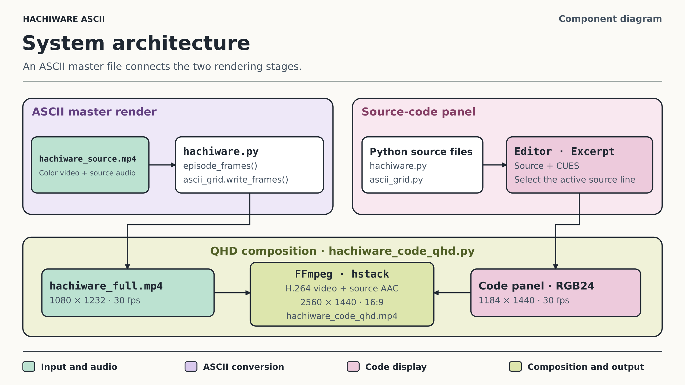

# Hachiware sings in ASCII

[한국어](README.ko.md) · [Watch the film on YouTube](https://youtu.be/brybTT7F2sg?si=imUgZBDhkl2_aS32) · [Engineering diagrams](docs/design.md)

Hachiware plays the guitar on the left. The Python lines that draw each scene scroll on the right. At 28.3 seconds, when the clapping starts, the panel lands on line 248 of `hachiware.py`, where the shot’s framing is set. The film uses the original Korean soundtrack, including the song and dialogue. [Clapping shot in the source](hachiware.py#L248)

## Render the QHD film

Install Python, `ffmpeg` with `libx264`, and `ffprobe`. The code panel uses DejaVu Sans Mono or Consolas for Latin text, and Noto Sans KR, Noto Sans CJK KR or Malgun Gothic for Korean. From the repository directory, run

~~~bash
python -m venv .venv
source .venv/bin/activate
python -m pip install -r requirements.txt
~~~

On Windows PowerShell, activate the environment with `.\.venv\Scripts\Activate.ps1`.

Supply a local copy of the Korean episode 11 cut, “혼잣말”, as `hachiware_source.mp4`. Its timeline spans 2,701 frames at 30 fps. The first command draws a 1080 × 1232 ASCII master with source audio. The second adds the code panel and writes a 2560 × 1440 (16:9) H.264 MP4.

~~~bash
python hachiware.py --episode-11 hachiware_source.mp4 hachiware_full.mp4
python hachiware_code_qhd.py hachiware_full.mp4 hachiware_code_qhd.mp4
~~~

If you already have `hachiware_full.mp4`, start with the second command. Choose a fresh output filename for each rerender. The finished cut runs for about 90 seconds at 30 fps. Both stages copy the original AAC audio without re-encoding it.

To try the ASCII renderer with another clip, use the command below. It frames the subject automatically and writes a silent 1080 × 1232 video.

~~~bash
python hachiware.py input.mp4 ascii.mp4
~~~

## How the code follows the picture

`CUES` maps 20 points on the timeline to lines in the Python files. The opening three seconds show the code that draws the title card. At frame 90 the guitar performance starts, and the panel switches to the palette for the fur and guitar. [Cue sheet](hachiware_code_qhd.py#L59)

| File | Role |
| --- | --- |
| [hachiware.py](hachiware.py) | Classifies fur, hair and guitar colors. Sets the framing and character density for each shot. |
| [ascii_grid.py](ascii_grid.py) | Builds a glyph mask for each character, colors the grid and writes the frames to video. |
| [hachiware_code_qhd.py](hachiware_code_qhd.py) | Reads the actual source lines, draws the right-hand panel and combines it with the movie and audio. |

The design notes trace a frame through the renderer and explain when the panel scrolls or holds a line. [Eight engineering diagrams](docs/design.md)

## License

The code and design diagrams are available under the MIT License. Copyright © 2026 Kyung-Bo Kim (김경보). The original animation and recording belong to their respective rights holders. [Full license](LICENSE)
