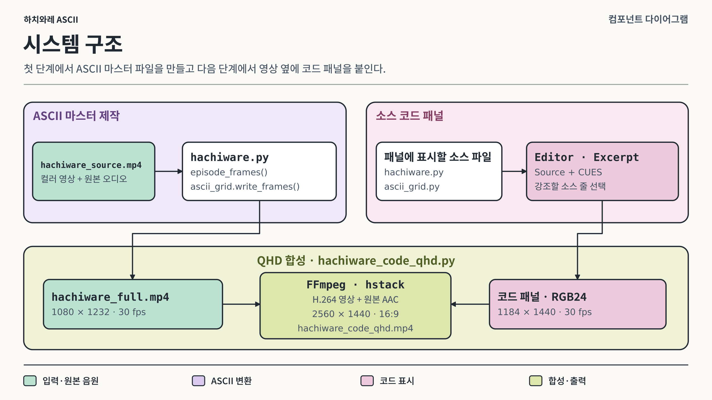
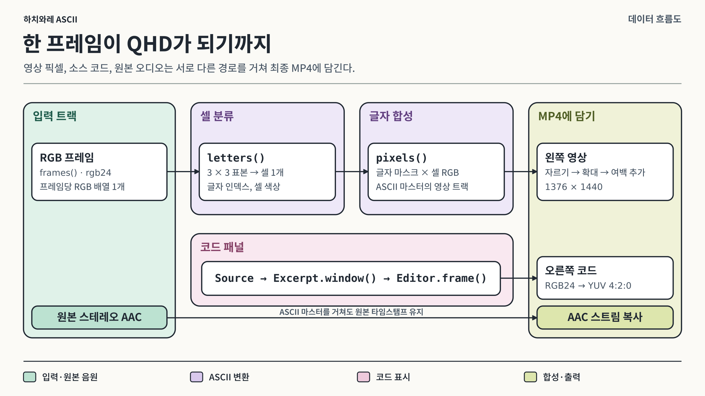
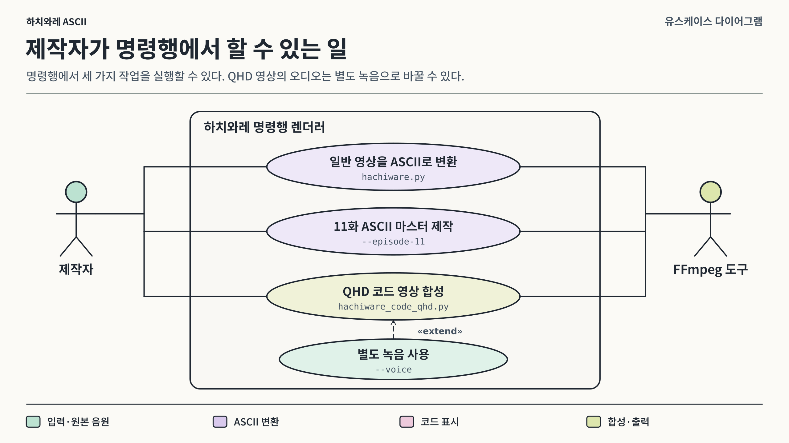
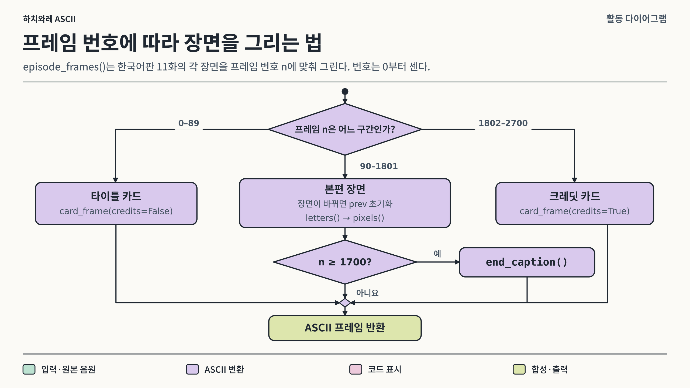
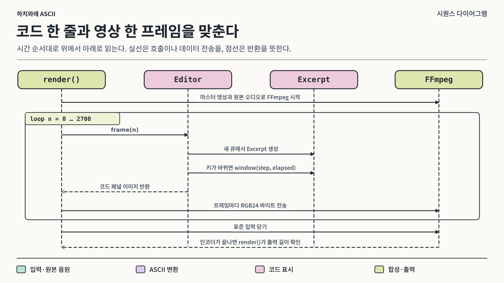
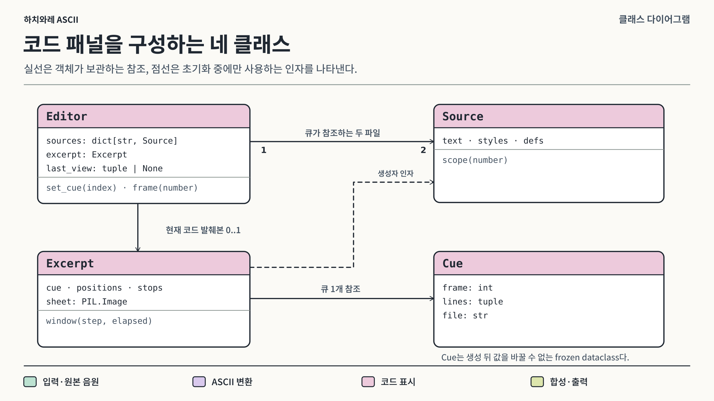
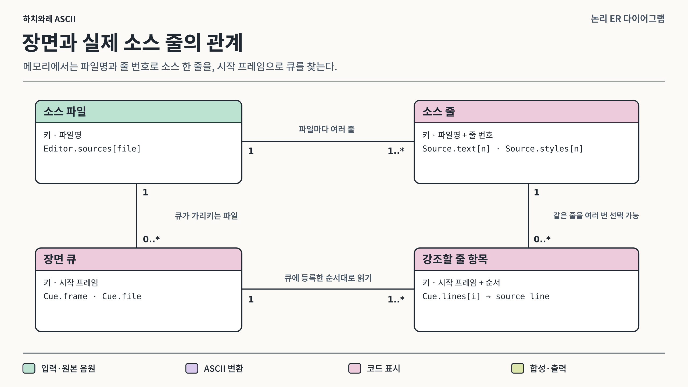
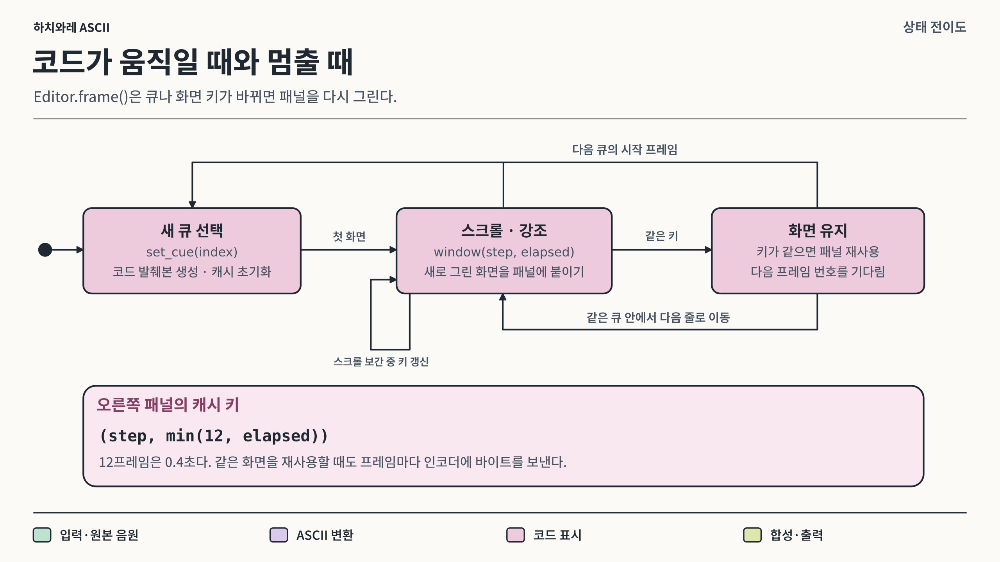

# 하치와레 렌더러 설계

[한국어 README](../README.ko.md) · [English](design.md)

## 시스템 구조

원본을 ASCII로 그리는 일과 화면에 코드를 붙이는 일은 따로 실행합니다. 두 프로그램을 잇는 파일은 `hachiware_full.mp4`입니다. 이 파일에 글자로 그린 영상과 원본 소리가 함께 들어 있어 코드 패널만 고칠 때는 QHD 합성부터 다시 실행하면 됩니다. 왼쪽 영상의 너비는 1376픽셀, 오른쪽 코드 패널은 1184픽셀입니다. [합성 코드](../hachiware_code_qhd.py#L284)

[편집용 SVG](diagrams/ko/architecture.svg)

도면은 아포지 설계도의 굵은 윤곽선과 둥근 상자를 따랐습니다. 민트색은 입력 영상과 음원, 연보라색은 ASCII 변환, 장밋빛은 코드 표시, 연두색은 합성과 출력을 가리킵니다. 각 상자에는 색과 함께 역할도 적었습니다. [아포지 설계도](https://github.com/sel00000/Apogee/blob/c0086bfeaccf59c46071f918361fe1a2aaa99ba0/docs/readme/architecture.ko.png)

## 데이터 흐름도

`letters()`는 셀마다 3 × 3개의 표본을 읽어 글자와 색을 고릅니다. 기본 격자는 135열 88행이고 글자 한 칸은 8 × 14픽셀입니다. 422번 프레임에는 두 인물이 함께 나옵니다. 이처럼 넓게 잡는 세 장면에서는 격자를 270열 176행으로 늘리고 글자 크기를 4 × 7픽셀로 줄입니다. `pixels()`는 글자 마스크에 셀 색을 곱해 RGB 프레임을 만듭니다. 소리는 이 계산을 거치지 않고 두 MP4에 차례로 복사됩니다. [글자 선택](../hachiware.py#L163) · [픽셀 합성](../ascii_grid.py#L37)

[편집용 SVG](diagrams/ko/data-flow.svg)

## 유스케이스 다이어그램

제작자는 일반 영상을 무음 ASCII로 바꾸거나 `--episode-11`로 원본 소리가 담긴 11화 ASCII 영상을 만들 수 있습니다. QHD 합성은 이 11화 영상을 입력으로 받습니다. 기본 설정에서는 한국어판 노래와 대사가 그대로 나옵니다. 별도 녹음으로 바꾸려면 합성 명령에 `--voice 녹음.wav`를 붙입니다. [ASCII 변환 명령](../hachiware.py#L379) · [오디오 선택](../hachiware_code_qhd.py#L291)

[편집용 SVG](diagrams/ko/use-cases.svg)

## 활동 다이어그램

프레임 번호는 0부터 셉니다. `episode_frames()`는 0~89번에서 타이틀을 그리고 90~1801번에서는 본편의 15개 장면에 맞춰 구도를 잡습니다. 장면이 바뀔 때마다 이전 셀 값을 비워 앞 장면의 색이 따라오지 않게 합니다. 1700~1801번에서는 ‘끝’ 말풍선도 따로 그립니다. 1802번부터 마지막 2700번까지는 크레딧에 더 작은 글자를 써서 가는 한글 획을 살립니다. [장면별 구도](../hachiware.py#L240) · [프레임 분기](../hachiware.py#L352)

[편집용 SVG](diagrams/ko/activity.svg)

## 시퀀스 다이어그램

렌더링을 시작할 때 `Source`는 두 파이썬 파일을 한 번씩 읽어 문법에 따라 색을 정합니다. 이후 `render()`가 프레임마다 `Editor.frame(n)`을 호출합니다. `Editor`는 구간이 바뀌면 `Excerpt`를 만들고 강조할 줄이나 스크롤 위치가 바뀌면 패널을 다시 그립니다. 같은 화면이 이어지는 동안에도 프레임마다 FFmpeg에 패널 데이터를 보냅니다. [소스 읽기](../hachiware_code_qhd.py#L108) · [패널 전송](../hachiware_code_qhd.py#L319)

[편집용 SVG](diagrams/ko/sequence.svg)

## 클래스 다이어그램

`Cue`에는 구간의 시작 프레임, 파일명, 강조할 줄 번호가 들어 있습니다. `Source`는 파일의 원문과 문법 색상, 함수나 대입문이 차지하는 줄 범위를 보관합니다. `Excerpt`는 한 구간에 필요한 줄을 미리 그려 두고 스크롤할 때 그중 일부만 잘라 씁니다. `Editor`는 두 `Source`와 현재 `Excerpt`를 관리합니다. [Cue](../hachiware_code_qhd.py#L47) · [Source](../hachiware_code_qhd.py#L108) · [Excerpt](../hachiware_code_qhd.py#L160) · [Editor](../hachiware_code_qhd.py#L240)

[편집용 SVG](diagrams/ko/classes.svg)

## 개체 관계도

장면과 소스 줄의 연결 정보는 메모리에 둡니다. 파일명과 줄 번호로 소스 한 줄을 찾을 수 있습니다. 시작 프레임과 `Cue.lines` 안의 순번을 알면 그 구간에서 어떤 줄을 강조할지도 확인할 수 있습니다. 예를 들어 `Cue(849, (248,))`는 849번 프레임부터 `hachiware.py`의 248번째 줄을 보여 주라는 뜻입니다. 20개 구간에 담긴 줄 번호는 중복을 포함해 모두 71개입니다. [큐 목록](../hachiware_code_qhd.py#L59) · [박수 장면](../hachiware.py#L248)

[편집용 SVG](diagrams/ko/data-model.svg)

## 상태 전이도

강조 표시가 다음 줄로 옮겨가는 데는 최대 12프레임(0.4초)이 걸립니다. `Editor.frame()`은 줄의 순번과 그 줄에서 지난 프레임 수로 만든 키 `(step, min(12, elapsed))`를 직전 값과 비교합니다. 키가 같으면 그려 둔 패널을 다시 쓰고 다음 줄이나 새 구간으로 넘어가면 화면을 갱신합니다. [스크롤 계산](../hachiware_code_qhd.py#L200) · [패널 재사용](../hachiware_code_qhd.py#L263)

[편집용 SVG](diagrams/ko/state.svg)
