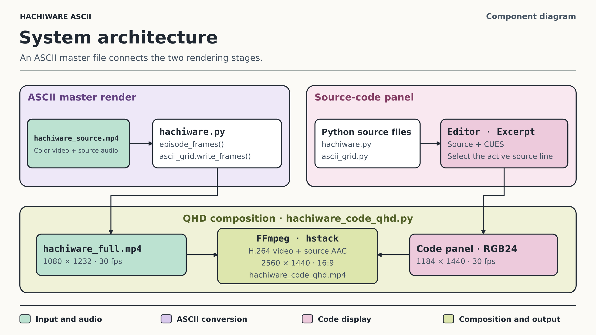
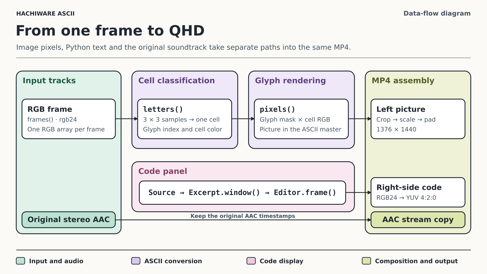
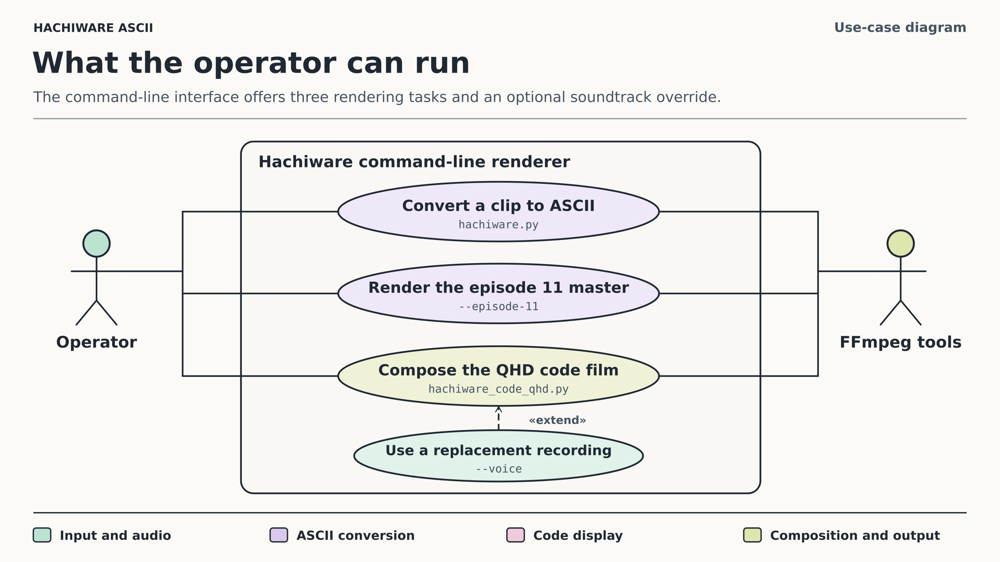
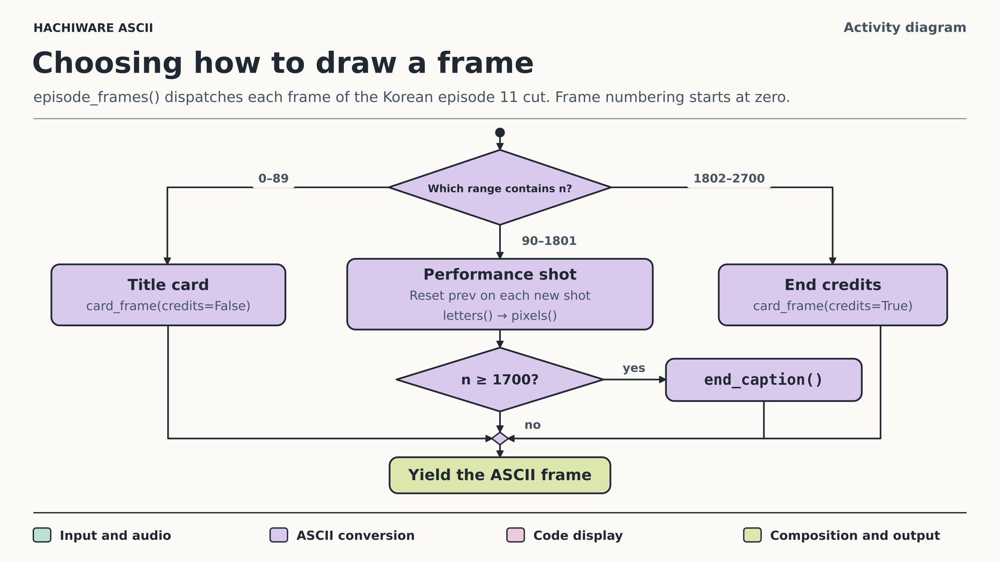
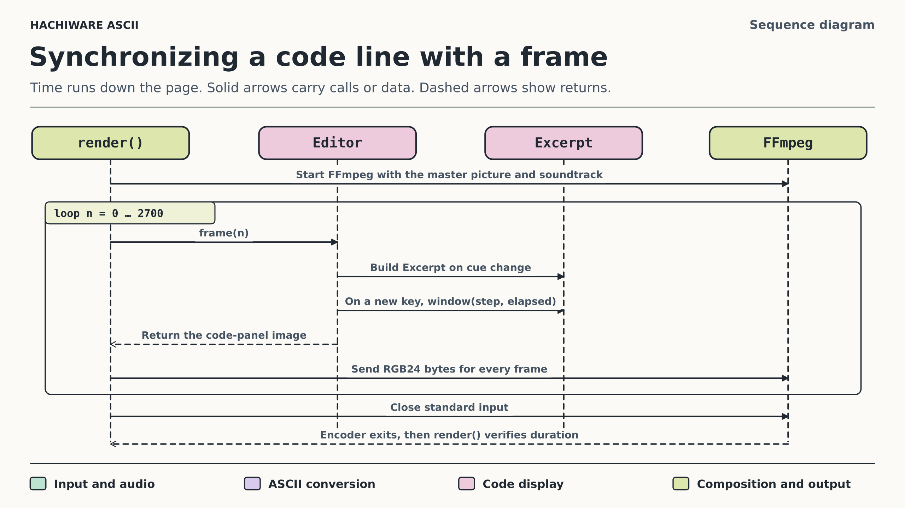
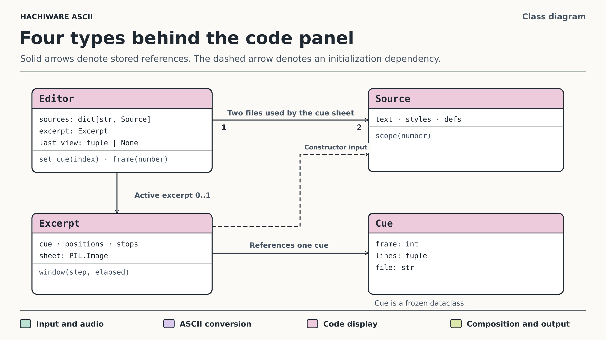
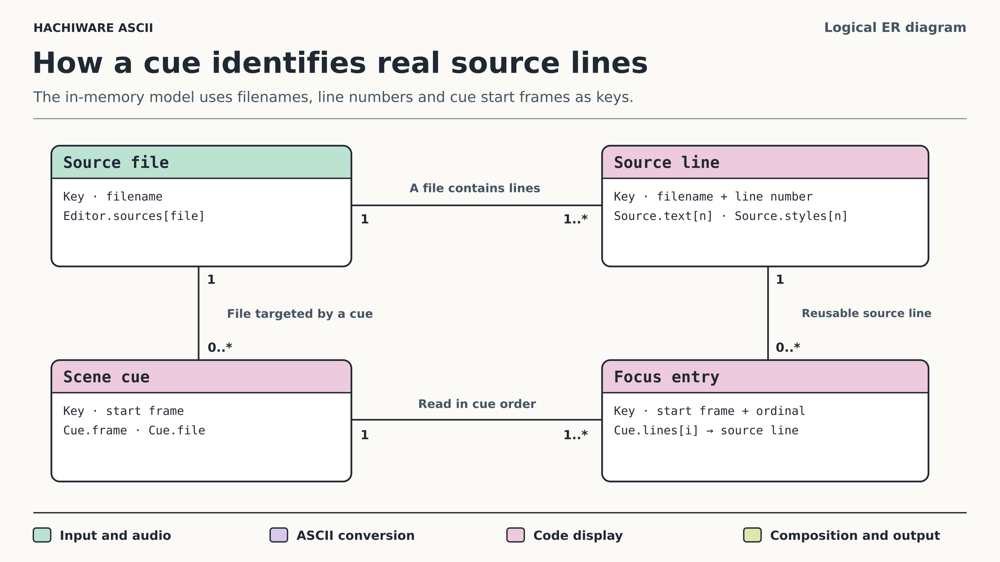
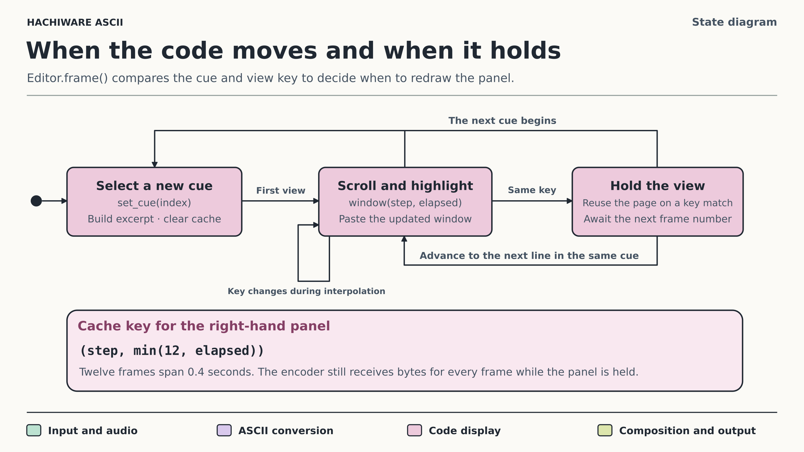

# Hachiware renderer design

[English README](../README.md) · [한국어](design.ko.md)

## System architecture

The two programs exchange one file, `hachiware_full.mp4`. It holds the ASCII picture and original soundtrack, so an edit to the code panel only requires rerunning the QHD compositor. The picture takes up the left 1376 pixels and the code takes up the remaining 1184. [Compositor](../hachiware_code_qhd.py#L284)

[Editable SVG](diagrams/en/architecture.svg)

The rounded groups and dark outlines follow the Apogee architecture drawing. Mint marks input and audio, lilac the ASCII conversion, rose the code panel, and green the composition and output. Each group also has a text label. [Apogee architecture drawing](https://github.com/sel00000/Apogee/blob/c0086bfeaccf59c46071f918361fe1a2aaa99ba0/docs/readme/architecture.ko.png)

## Data flow

`letters()` samples a 3 × 3 block for each cell and chooses a glyph and color. The usual grid has 135 columns and 88 rows, with an 8 × 14 pixel tile for each glyph. Three wide shots, including the two-character shot at frame 422, use 270 columns and 176 rows with 4 × 7 tiles. `pixels()` multiplies the glyph mask by the cell color to produce RGB pixels. FFmpeg copies the audio track through both files. [Glyph selection](../hachiware.py#L163) · [Pixel composition](../ascii_grid.py#L37)

[Editable SVG](diagrams/en/data-flow.svg)

## Use cases

An operator can render a silent ASCII version of an arbitrary clip or use `--episode-11` to render the matching episode with its original audio. QHD composition takes the episode master as input. It uses the Korean song and dialogue by default. To supply a separate recording, pass `--voice recording.wav` to the compositor. [ASCII command](../hachiware.py#L379) · [Audio selection](../hachiware_code_qhd.py#L291)

[Editable SVG](diagrams/en/use-cases.svg)

## Activity diagram

`episode_frames()` draws the opening card for frames 0–89. Frames 90–1801 cover 15 performance shots. Each shot change resets the previous cell values so the old shot’s colors do not carry over. Frames 1700–1801 add a separate pass for the closing “끝” speech balloon. From frame 1802 through 2700, smaller glyphs preserve the fine Korean lettering on the credits. [Shot framing](../hachiware.py#L240) · [Frame dispatch](../hachiware.py#L352)

[Editable SVG](diagrams/en/activity.svg)

## Sequence diagram

At startup, `Source` reads each of the two Python files once and colors the tokens. Then `render()` calls `Editor.frame(n)` for each video frame. `Editor` builds an `Excerpt` when a new cue begins. A change of line or scroll position prompts a redraw. FFmpeg receives a panel for every frame, including the frames when the panel holds still. [Source parsing](../hachiware_code_qhd.py#L108) · [Per-frame output](../hachiware_code_qhd.py#L319)

[Editable SVG](diagrams/en/sequence.svg)

## Class diagram

`Cue` records a start frame, a filename and the source lines to highlight. `Source` holds the file text, token styles and the line ranges of its functions and assignments. `Excerpt` draws a sheet of source lines once per cue, then crops it as the view scrolls. `Editor` owns two `Source` objects and the current `Excerpt`. [Cue](../hachiware_code_qhd.py#L47) · [Source](../hachiware_code_qhd.py#L108) · [Excerpt](../hachiware_code_qhd.py#L160) · [Editor](../hachiware_code_qhd.py#L240)

[Editable SVG](diagrams/en/classes.svg)

## Entity relationships

The renderer keeps its cue data in memory. A filename and a line number identify one source line. A cue’s start frame and an index into `Cue.lines` identify one highlight within the cue. For example, `Cue(849, (248,))` brings up line 248 of `hachiware.py` when frame 849 starts. The 20 cues hold 71 line-number entries, counting repeats. [Cue sheet](../hachiware_code_qhd.py#L59) · [Clapping shot](../hachiware.py#L248)

[Editable SVG](diagrams/en/data-model.svg)

## State diagram

The scroll to the next line takes at most 12 frames (0.4 seconds). `Editor.frame()` compares `(step, min(12, elapsed))` with the previous view key. An identical key reuses the panel. A new line or cue triggers a redraw. [Scroll interpolation](../hachiware_code_qhd.py#L200) · [Panel reuse](../hachiware_code_qhd.py#L263)

[Editable SVG](diagrams/en/state.svg)
